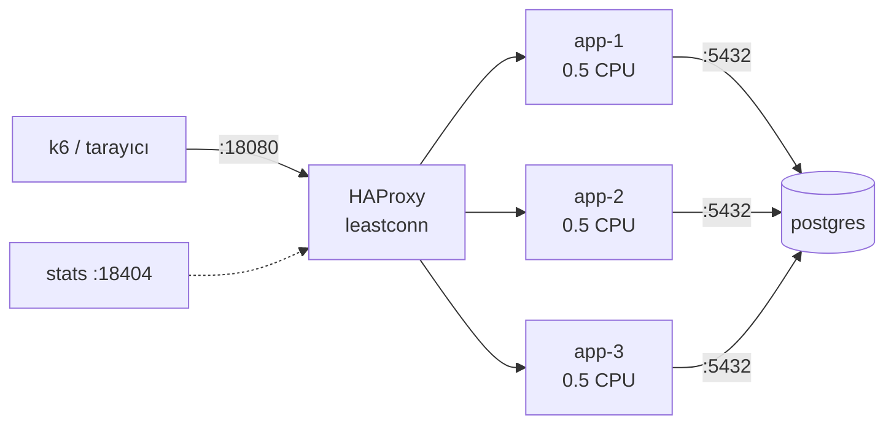

# edge-lab

Tek VM üzerinde çalışan, **trafik katmanını ölçmeye odaklı** bir laboratuvar.
Uygulama bilerek sıkıcı: bir URL shortener. Asıl konu, aynı uygulamanın farklı
topolojilerde (reverse proxy, load balancer, API gateway, cache, message broker)
nasıl davrandığını sayıyla göstermek.

Amaç "yeni bir bit.ly" değil; her katmanın ne kazandırdığını ve neye mal olduğunu
ölçmek.

## Durum

| Faz | Ne | Durum |
|---|---|---|
| 0 | Uygulama + Postgres + baseline | tamam (43 rps) |
| 1 | 3 replica + HAProxy | devam |
| 2 | Kong gateway (auth, kota, rate limit) | - |
| 3 | Redis cache (cache-aside, invalidation) | - |
| 4 | RabbitMQ (outbox, tıklama analitiği) | - |
| 5 | Resilience + hata matrisi | - |
| 6 | Control Room + CI perf gate | - |

## Mimari (Faz 1)



Üç app aynı imajı, aynı limitlerle çalıştırır; tek fark isimleri. HAProxy
`/healthz` ile sağlık kontrolü yapar ve `leastconn` ile dağıtır.

## Uçlar

| Yol | Açıklama |
|---|---|
| `POST /api/links` | `{"url": "...", "owner_key": "..."}` → 201, kısa kod üretir |
| `GET /{code}` | 302 redirect; bilinmeyen kod 404 |
| `DELETE /api/links/{code}` | `X-Owner-Key` başlığı eşleşmeli; 204/403/404 |
| `GET /healthz` | Liveness; DB'ye bakmaz |
| `GET /readyz` | Readiness; DB erişimi yoksa 503 |

`GET /{code}` için `302` seçildi, `301` değil. Gerekçe:
[`docs/adr/0001-redirect-status.md`](docs/adr/0001-redirect-status.md).

## Çalıştırma

### Gereksinimler

- Docker Engine + Compose v2 (VM'de)
- Python 3.12 + [uv](https://docs.astral.sh/uv/) (Windows'ta geliştirme)
- k6 (Windows host'ta; VM'de değil)

### VM'de yığın

```bash
cp deploy/.env.example deploy/.env   # POSTGRES_PASSWORD'u değiştir
make up
make migrate
make seed
```

### Windows'ta geliştirme

```bash
cd app
uv sync
uv run pytest -q
uv run alembic upgrade head         # DATABASE_URL VM'i gösterir
uv run uvicorn edge_lab.main:app --port 18000
```

### Yük testi

k6 **host'ta** çalışır, VM'de değil: load generator ile ölçülen sistem aynı CPU'yu
paylaşırsa p95 anlamsızlaşır.

```powershell
k6 run -e BASE_URL=http://192.168.56.10:18080 loadtest/smoke.js
k6 run -e BASE_URL=http://192.168.56.10:18080 --summary-export docs/results/baseline.json loadtest/load.js
```

Tek bir sıcak kod üzerinden ölçmek için: `-e CODE=hotlink`.

### Ölçüm protokolü

İki test birlikte kullanılır, tek başına ikisi de yeterli değil:

| Test | Tip | Ne söyler |
|---|---|---|
| `loadtest/sweep.js` | kapalı çevrim, sabit VU | eşzamanlılık arttıkça gecikme nasıl değişiyor |
| `loadtest/load.js` | açık çevrim, kademeli rps | hangi varış hızında sistem doymaya başlıyor |

```powershell
./loadtest/run-sweep.ps1                       # 5,10,20,40,80,160 VU × 30s
k6 run --summary-export docs/results/step-run1.json loadtest/load.js
```

Okuma kuralı:

- Kapalı çevrimde gecikmenin diz kırdığı nokta **eşzamanlılık** sınırıdır.
- Açık çevrimde `dropped_iterations > 0` olduğu kademe **varış hızı** sınırıdır.
- İkisinin kesişimi baseline sayılır. Tek koşu yetmez: 3 koşu, medyan.

`load.js` eşikleri (`p95 < 100ms`, hata < %0.1) kademe testinde bilerek kırmızıya
döner; bu bir arıza değil, tavanın bulunduğunun işaretidir.

İlk koşu (`docs/results/overload-500rps-run1.json`) bilerek "aşırı yük" olarak
adlandırıldı: 500 rps teklif edildi, sistem 33 rps'te doydu, 5xx üretmedi,
gecikme kuyruk nedeniyle 15 saniyeye çıktı.


## Portlar

| Bileşen | VM (192.168.56.10) | Not |
|---|---|---|
| HAProxy | 18080 | tek giriş noktası |
| HAProxy stats | 18404 | `/stats` |
| app-1/2/3 | - | yalnızca `expose: 8000`, host'a açılmaz |
| postgres | 15432 | Windows'tan migration için |

## Seed verisi

`make seed` 1000 deterministik kod (`seed000`..`seed999`) ve bir sıcak kod
(`hotlink`) ekler. Gerçek kodlar rastgele base62; seed verisi sadece yük testinin
aynı satırları kullanabilmesi için sabit.

## Yapı

```
app/          FastAPI, SQLAlchemy, Alembic, Dockerfile
deploy/       compose.yml, .env.example
loadtest/     k6 senaryoları
docs/         ADR'ler, sonra runbook ve sonuçlar
```

## Bilinen sınırlar

- Tek VM: bütün container'lar aynı çekirdekleri paylaşır, "replica" ağ sıçraması yok.
- Faz 0'da auth yok; `owner_key` yalnızca sahiplik kontrolü için.
- Alarm/alerting henüz yok.
