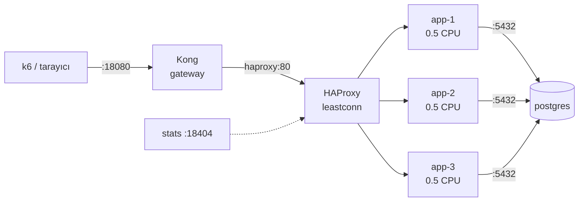

# edge-lab

Tek VM üzerinde çalışan, **trafik katmanını ölçmeye odaklı** bir laboratuvar.
Uygulama bilerek sıkıcı: bir URL shortener. Asıl konu, aynı uygulamanın farklı
topolojilerde (reverse proxy, load balancer, API gateway, cache, message broker)
nasıl davrandığını sayıyla göstermek.

Amaç "yeni bir bit.ly" değil; her katmanın ne kazandırdığını ve neye mal olduğunu
ölçmek.

## Durum

| Faz | Ne | Durum |
|---|---|---|
| 0 | Uygulama + Postgres + baseline | tamam (43 rps) |
| 1 | 3 replica + HAProxy | tamam (103 rps) |
| 2 | Kong gateway (geçiş + rate limit) | geçiş tamam (~1 ms/istek), rate limit sırada |
| 3 | Redis cache (cache-aside, invalidation) | - |
| 4 | RabbitMQ (outbox, tıklama analitiği) | - |
| 5 | Resilience + hata matrisi | - |
| 6 | Control Room + CI perf gate | - |

## Mimari (Faz 2)



Faz 1'de bu şemanın Kong'suz hâli ölçüldü: **43 → 103 rps**. Faz 2'nin tek
sorusu, aynı yükün önüne bir gateway koymanın neye mal olduğu.

Kong DB-less modda çalışır: rota tanımı `deploy/kong/kong.yml` dosyasından
okunur, Kong'un kendi veritabanı yoktur.

Teşhis için ikinci bir kapı var: `:18090` doğrudan HAProxy'ye gider. Yük
testlerinde kullanılmaz; "sorun gateway'de mi, arkasında mı" sorusunu iki curl
ile ayırmak içindir.

Ölçüm sonucu: doygun yükte (40 VU) Kong'un throughput maliyeti ölçülemedi;
doymamış yükte (1 VU) istek başına **~0.8 ms medyan, ~1.3 ms ortalama** ekliyor.
Ayrıntı: [`docs/results/README.md`](docs/results/README.md).

## Uçlar

| Yol | Açıklama |
|---|---|
| `POST /api/links` | `{"url": "...", "owner_key": "..."}` → 201, kısa kod üretir |
| `GET /{code}` | 302 redirect; bilinmeyen kod 404 |
| `DELETE /api/links/{code}` | `X-Owner-Key` başlığı eşleşmeli; 204/403/404 |
| `GET /healthz` | Liveness; DB'ye bakmaz |
| `GET /readyz` | Readiness; DB erişimi yoksa 503 |

`GET /{code}` için `302` seçildi, `301` değil. Gerekçe:
[`docs/adr/0001-redirect-status.md`](docs/adr/0001-redirect-status.md).

## Çalıştırma

### Gereksinimler

- Docker Engine + Compose v2 (VM'de)
- Python 3.12 + [uv](https://docs.astral.sh/uv/) (Windows'ta geliştirme)
- k6 (Windows host'ta; VM'de değil)

### VM'de yığın

```bash
cp deploy/.env.example deploy/.env   # POSTGRES_PASSWORD'u değiştir
make up
make migrate
make seed
```

### Windows'ta geliştirme

```bash
cd app
uv sync
uv run pytest -q
uv run alembic upgrade head         # DATABASE_URL VM'i gösterir
uv run uvicorn edge_lab.main:app --port 18000
```

### Yük testi

k6 **host'ta** çalışır, VM'de değil: load generator ile ölçülen sistem aynı CPU'yu
paylaşırsa p95 anlamsızlaşır.

```powershell
k6 run -e BASE_URL=http://192.168.56.10:18080 loadtest/smoke.js
k6 run -e BASE_URL=http://192.168.56.10:18080 --summary-export docs/results/baseline.json loadtest/load.js
```

Tek bir sıcak kod üzerinden ölçmek için: `-e CODE=hotlink`.

### Ölçüm protokolü

İki test birlikte kullanılır, tek başına ikisi de yeterli değil:

| Test | Tip | Ne söyler |
|---|---|---|
| `loadtest/sweep.js` | kapalı çevrim, sabit VU | eşzamanlılık arttıkça gecikme nasıl değişiyor |
| `loadtest/load.js` | açık çevrim, kademeli rps | hangi varış hızında sistem doymaya başlıyor |

```powershell
./loadtest/run-sweep.ps1 -Prefix faz2       # 5,10,20,40,80,160 VU × 30s
k6 run --summary-export docs/results/faz2-step-run1.json loadtest/load.js
```

`-Prefix` her dosyayı `faz2-sweep-vus-<n>.json` diye yazar. Prefix vermezsen
sabit isim kullanılır ve önceki fazın ölçümlerinin üzerine geçer.

Okuma kuralı:

- Kapalı çevrimde gecikmenin diz kırdığı nokta **eşzamanlılık** sınırıdır.
- Açık çevrimde `dropped_iterations > 0` olduğu kademe **varış hızı** sınırıdır.
- Kapasiteyi **kapalı çevrim** verir: seviye artarken rps sabitlenip gecikme
  artıyorsa tavan oradadır. Açık çevrimde kuyruk yüzünden düşen istekler
  kapasiteyi olduğundan yüksek gösterebilir; iki test çelişirse kapalı çevrim
  esas alınır.
- Faz 1'den itibaren tek koşu kaydedilir. İki koşu arasında %20'den fazla fark
  çıkarsa önce ortamı (VM yükü, host) sorgularız.

`load.js` eşikleri (`p95 < 100ms`, hata < %0.1) kademe testinde bilerek kırmızıya
döner; bu bir arıza değil, tavanın bulunduğunun işaretidir.

İlk koşu (`docs/results/overload-500rps-run1.json`) bilerek "aşırı yük" olarak
adlandırıldı: 500 rps teklif edildi, sistem 33 rps'te doydu, 5xx üretmedi,
gecikme kuyruk nedeniyle 15 saniyeye çıktı.


## Portlar

| Bileşen | VM (192.168.56.10) | Not |
|---|---|---|
| Kong (proxy) | 18080 | dışarıya açılan tek kapı; `BASE_URL` buraya bakar |
| Kong admin | 18081 | route/plugin denetimi |
| HAProxy | 18090 | yalnızca teşhis: Kong'u atlar |
| HAProxy stats | 18404 | `/stats` |
| app-1/2/3 | - | yalnızca `expose: 8000`, host'a açılmaz |
| postgres | 15432 | Windows'tan migration için |

## Seed verisi

`make seed` 1000 deterministik kod (`seed000`..`seed999`) ve bir sıcak kod
(`hotlink`) ekler. Gerçek kodlar rastgele base62; seed verisi sadece yük testinin
aynı satırları kullanabilmesi için sabit.

## Yapı

```
app/          FastAPI, SQLAlchemy, Alembic, Dockerfile
deploy/       compose.yml, .env.example
deploy/haproxy/  LB yapılandırması
deploy/kong/     gateway rotaları (DB-less, kong.yml)
loadtest/     k6 senaryoları + sweep betiği
docs/adr/     karar günlüğü
docs/results/ ham ölçüm JSON'ları + faz tabloları
```

## Bilinen sınırlar

- Tek VM: bütün container'lar aynı çekirdekleri paylaşır, "replica" ağ
  sıçraması yok. VM donanım hızlandırmasız (NEM) çalıştığı için istek başına
  CPU maliyeti yüksek; mutlak rps düşük.
- Postgres tek instance ve 1.0 vCPU. Faz 1'de kapasite 3× değil 2.4× arttı;
  bunun sebebinin bu paylaşılan darboğaz olduğu **ölçülmedi**, sadece
  işaret edildi.
- Gecikme dağılımının kuyruğu (p99) bazı koşularda 7-8 saniyeye çıkıyor;
  sebebi tespit edilmedi. 1 VU'da bile p99 ~75 ms.
- Ölçüm gürültüsü yüksek: aynı test iki ayrı oturumda 103 ve 173 rps verdi.
  Faz karşılaştırmaları bu yüzden aynı oturumda A/B olarak yapılır
  (`docs/results/README.md`).
- Auth yok; Kong şimdilik yalnızca geçiş modunda. Rate limit Faz 2b'de.
- Kong upstream adresini açılışta çözer; HAProxy yeniden başlayıp IP
  değiştirirse Kong eski adrese gitmeye çalışabilir.
- Alarm/alerting henüz yok.
